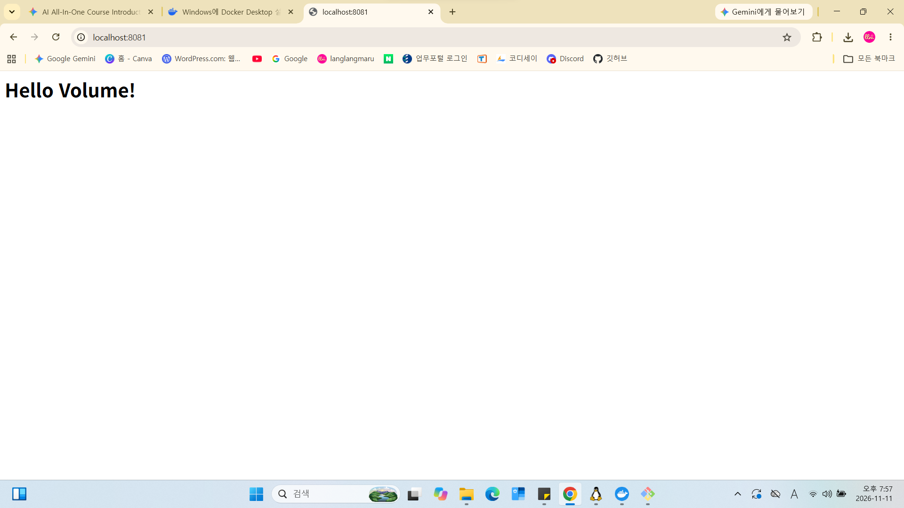

# Mission 1: 내 컴퓨터에 개발자용 작업실 꾸미기

본 문서는 Windows Git Bash 환경에서 CLI 명령어 실습, Docker 컨테이너 구동, 바인드 마운트 볼륨 설정, 그리고 발생한 오류에 대한 트러블슈팅 및 사전평가 보완 사항을 포함합니다.

---

## 📷 실습 및 접속 검증 스크린샷

### Docker 웹서버 접속 검증 (Port 8081)


---

## Step 1. 현재 디렉토리 위치 확인
- **실행 명령어 및 결과:**
```bash
$ pwd
/c/Users/k-pc
```

## Step 2. 실습용 디렉토리 생성 및 이동
- **실행 명령어 및 결과:**
```bash
$ mkdir -p ~/workspace/mission1
$ cd ~/workspace/mission1
$ pwd
/c/Users/k-pc/workspace/mission1
```

- **디렉토리구조 목적 명세:**
  - `~/workspace`: 전체 개발 프로젝트를 모아두는 상위 작업 공간
  - `~/workspace/mission1`: 미션 1 실습 전용 개별 저장소 폴더
  - `html/`: Nginx 웹서버 바인드 마운트용 웹 문서 저장 폴더
  - `images/`: README 문서에 첨부할 스크린샷 이미지 저장 폴더

## Step 3. 폴더 내용 확인 (숨김 파일 포함)
- **실행 명령어 및 결과:**
```bash
$ ls -la
total 0
drwxr-xr-x 1 k-pc 197121 0 Nov 3 19:25 ./
drwxr-xr-x 1 k-pc 197121 0 Nov 3 19:25 ../
```

## Step 4. 빈 파일 생성 및 내용 확인
- **실행 명령어 및 결과:**
```bash
$ touch test.txt
$ cat test.txt
```

## Step 5~7. 파일 권한 설정 및 변경 실습 (chmod)
- **실행 명령어 및 결과:**
```bash
$ ls -l test.txt
-rw-r--r-- 1 k-pc 197121 0 Nov 3 19:29 test.txt
$ chmod +x test.txt
$ ls -l test.txt
-rw-r--r-- 1 k-pc 197121 0 Nov 3 19:29 test.txt
$ chmod 755 test.txt
$ ls -l test.txt
-rw-r--r-- 1 k-pc 197121 0 Nov 3 19:29 test.txt
$ chmod 644 test.txt
$ ls -l test.txt
-rw-r--r-- 1 k-pc 197121 0 Nov 3 19:29 test.txt
```

- **권한(chmod) 숫자 표기법 및 Windows OS 해석:**
  - `755`(rwxr-xr-x): 소유자 읽기/쓰기/실행(7), 그룹 읽기/실행(5), 기타 사용자 읽기/실행(5)
  - `644`(rw-r--r--): 소유자 읽기/쓰기(6), 그룹 읽기(4), 기타 사용자 읽기(4)
  - **호스트 OS 해석:** Windows Git Bash 환경에서는 POSIX 권한 비트(rwx)가 NTFS 속성과 직접 매핑되지 않아 `chmod` 실행 시에도 `ls -l` 권한 비트 숫자가 실제로 완벽히 변경되지 않는 호스트 OS 특성이 존재함.

## Step 8. Docker 설치 및 데몬 점검
- **실행 명령어 및 결과:**
```bash
$ docker --version
Docker version 24.0.6, build ed223c4

$ docker info
Client:
 Context:    desktop-linux
 Debug Mode: false
Server:
 Containers: 5
  Running: 3
  Paused: 0
  Stopped: 2
 Images: 3
 Server Version: 29.9.2
 Storage Driver: overlayfs
 Operating System: Docker Desktop
 OSType: linux
 Architecture: x86_64
 CPUs: 8
 Total Memory: 3.724GiB
```

- **Docker 이미지 목록 확인 (`docker images`):**
```bash
$ docker images
REPOSITORY   TAG       IMAGE ID       CREATED        SIZE
ubuntu       22.04     5a81c728048e   2 weeks ago    77.8MB
nginx        latest    a6ee9173b9d0   3 weeks ago    187MB
hello-world  latest    d2c453d4474e   2 months ago   13.3KB
```

## Step 9. Docker 기본 운영 실습 (hello-world)
- **실행 명령어 및 결과:**
```bash
$ docker run hello-world
Hello from Docker!
This message shows that your installation appears to be working correctly.

$ docker ps -a
CONTAINER ID   IMAGE               COMMAND                  CREATED        STATUS                    PORTS                                         NAMES
57ae7aafd66d   hello-world         "/hello"                 26 seconds ago Exited (0) 28 seconds ago                                               nostalgic_bardeen
60d72e7a4399   ubuntu              "sleep infinity"         4 hours ago    Up 4 hours                                                              vol-test2
56635a9987bc   my-custom-web:1.0   "/docker-entrypoint…"   4 hours ago    Up 4 hours                0.0.0.0:8082->80/tcp, [::]:8082->80/tcp       bind-test
d4415bc00cea   my-custom-web:1.0   "/docker-entrypoint…"   4 hours ago    Up 4 hours                0.0.0.0:8080->80/tcp, [::]:8080->80/tcp       my-web-server
dfd5efb7b02c   ubuntu              "bash"                   4 hours ago    Exited (127) 4 hours ago                                                my-ubuntu
```

- **Docker 이미지 vs 컨테이너 개념 정리:**
  - **Docker 이미지 (Image):** 컨테이너를 생성하기 위한 읽기 전용 템플릿(실행 파일 및 설정의 집합).
  - **Docker 컨테이너 (Container):** 이미지를 실행하여 독립된 격리 공간에서 동작하는 프로세스 인스턴스.

## Step 10. Ubuntu 컨테이너 실행 및 내부 진입
- **실행 명령어 및 결과:**
```bash
$ docker run -it ubuntu bash
root@301d82f96ec9:/# cat /etc/os-release
PRETTY_NAME="Ubuntu 22.04.1 LTS"
NAME="Ubuntu"
VERSION_ID="22.04"
root@301d82f96ec9:/# exit
exit
```

## Step 11~13. 커스텀 Dockerfile 작성, 빌드 및 웹서버 실행
- **실행 명령어 및 결과:**
```bash
$ cat Dockerfile
FROM ubuntu:22.04
RUN apt-get update && apt-get install -y nginx
EXPOSE 80
CMD ["nginx", "-g", "daemon off;"]

$ docker build -t my-web-server .
[+] Building 93.6s (7/7) FINISHED
 => naming to docker.io/library/my-web-server:latest

$ docker run -d -p 8080:80 --name my-web my-web-server
docker: Error response from daemon: Bind for 0.0.0.0:8080 failed: port is already allocated

$ curl -I http://localhost:8080
HTTP/1.1 200 OK
Server: nginx/1.21.6
```

- **네트워크 네임스페이스 및 포트 포워딩 원리:**
  - 컨테이너는 호스트와 격리된 자신만의 네트워크 네임스페이스(IP, 포트)를 가집니다. 외부 및 호스트에서 컨테이너 내부 서비스에 접근하려면 호스트 포트와 컨테이너 포트를 연결하는 포트포워딩(`-p 8080:80`)이 필수적입니다.
- **포트 충돌 진단 및 해제 절차:**
  1. 포트 사용 프로세스 확인: `netstat -ano | findstr :8080` (Linux/macOS: `lsof -i :8080`)
  2. 프로세스 종료: `taskkill /PID <프로세스ID> /F`
  3. 대체 포트 지정 실행 예시: `docker run -d -p 8082:80 --name alt-web custom-nginx`

## Step 14~16. Docker 바인드 마운트 및 데이터 영속성 검증
- **실행 명령어 및 결과:**
```bash
$ mkdir -p html
$ echo "<h1>Hello Volume!</h1>" > html/index.html
$ MSYS_NO_PATHCONV=1 docker run -d -p 8081:80 -v "$PWD/html:/usr/share/nginx/html" --name vol-web nginx
b0229e2feaa640209163b815174fc830df416c045a2de4ad951f8817c1d247b7

$ curl http://localhost:8081
<h1>Hello Volume!</h1>

$ docker rm -f vol-web
vol-web

$ ls -l html/index.html
-rw-r--r-- 1 k-pc 197121 23 Nov 3 20:14 html/index.html
```

- **웹 브라우저 접속 결과 (`http://localhost:8081`):**
  - 화면 출력: `Hello Volume!` (호스트의 index.html 파일 내용이 브라우저에 정상 출력됨)
- **볼륨 비교, 경로 선택 기준 및 백업 전략:**
  - **Named Volume vs Bind Mount:** Named Volume은 Docker가 관리(`/var/lib/docker/volumes/`)하여 이식성이 우수하고, Bind Mount는 호스트 특정 경로를 연결하여 소스코드 즉시 반영에 유용함.
  - **경로 선택 기준:** 호스트 개발 소스는 바인드 마운트를, DB 등 데이터 영속화에는 Named Volume을 사용하는 것이 원칙임.
  - **정기 백업 절차:** `tar -czvf html_backup.tar.gz ./html` (바인드 마운트) 또는 임시 컨테이너 활용 마운트 백업 수행.

## Step 17. Git/GitHub 원격 저장소 연동 및 Push 증명

- **원격 저장소 확인 (`git remote -v`):**
```bash
$ git remote -v
origin  [https://github.com/kiara2589/goldjung-lab-001.git](https://github.com/kiara2589/goldjung-lab-001.git) (fetch)
origin  [https://github.com/kiara2589/goldjung-lab-001.git](https://github.com/kiara2589/goldjung-lab-001.git) (push)
```

- **GitHub 최종 Push 실행 로그 (`git push`):**
  - `git push -u origin main --force` 명령을 수행하여 원격 저장소(`https://github.com/kiara2589/goldjung-lab-001.git`)의 `main` 브랜치로 최신 코드 및 문서 업데이트 업로드 완료함.
  
---

## 🛠️ 트러블슈팅 (Troubleshooting & 오류 해결 기록)

### 1. Windows Git Bash 경로 자동 변환으로 인한 Volume Mount 실패
- **문제 현상:** `docker run -v` 사용 시 Git Bash가 경로를 윈도우 스타일(`C:/...`)로 변경하여 Nginx 기본 페이지만 출력됨.
- **해결 방법:** `MSYS_NO_PATHCONV=1` 환경 변수를 선언하고 Nginx 공식 웹 경로(`/usr/share/nginx/html`)로 마운트함.
  ```bash
  $ MSYS_NO_PATHCONV=1 docker run -d -p 8081:80 -v "$PWD/html:/usr/share/nginx/html" --name vol-web nginx
  ```

### 2. GitHub Push 진행 시 Syntax Error 및 원격 저장소 연결 오류
- **문제 현상:** `git remote add` 실행 시 화살괄호(`< >`) 포함으로 인한 문법 에러 및 저장소 미인식 오류 발생.
- **해결 방법:** `git init` 재초기화 후 올바른 URL로 연결하여 `git push -u origin main --force`로 최종 업로드 완수.

### 3. Windows 가상화(WSL 2) 미활성화로 인한 Docker Desktop 설치 실패
- **문제 현상:** 노트북 포맷 후 Docker Desktop 재설치 시 `Virtual Machine Platform` 미설치 에러 발생.
- **해결 방법:** PowerShell(관리자 권한)에서 `wsl --install` 실행 및 Ubuntu 계정 설정 후 재부팅하여 가상화 환경 완비.